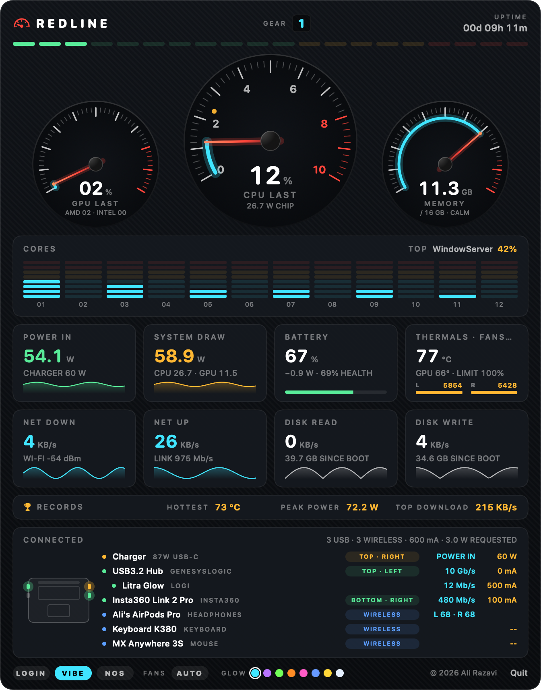

# Redline

**Your whole Mac on one tuner-style dashboard.** A small needle in the menu bar: click it and a gauge cluster shows what the whole machine is doing.

<p></p>

## Why I built it

To know what my Mac is doing I had to open Activity Monitor and click through five tabs of tables. Power from the charger, what each USB device asks for, temperatures and fan speed are not in there at all.

I wanted one click instead of a hunt. And I wanted it to be fun: a dashboard like the gauge cluster of a tuned import car, calm and satisfying to look at.

I decide what it should do and test it; an AI coding assistant (Claude Code) writes the code.

Copyright (c) 2026 Ali Razavi. All rights reserved. See `LICENSE`.

## What it shows

- **CPU Last** (big tachometer), **GPU Last** and **Memory** dials, each with an amber dot marking the peak since you opened the card
- Shift lights and a gear indicator that follow CPU load; one LED column per CPU core; the busiest app right now
- **Power in**, **System draw** (whole Mac, plus CPU and GPU watts), **Battery**, **Thermals** (temperatures and fan speed)
- **Network** down and up with Wi-Fi signal and link rate; **Disk** read and write
- **Records**: all-time highs for CPU temperature, power draw and download speed (click to reset)
- **Connected**: every external USB device with its speed and requested current, Bluetooth devices such as AirPods with their battery levels, the charger, and a small top view of the laptop where the sockets in use glow (green = device, amber = charger).
- A red THROTTLED badge when macOS slows the CPU down because of heat

## Using it

- Click the needle in the menu bar. Every needle sweeps to the top and settles.
- Drag the card by its background to move it. It has one fixed size.
- Click anywhere outside the card, or press Esc, to close it.
- **VIBE**: club lighting behind the dials, driven by whatever the Mac is playing: waves, a glow behind each dial, rings off the big dial on every kick, a strobe, and mirrored sparks that are released on the beat and rise higher when the music lifts. It listens only while the card is open and VIBE is on; the sound is not changed, stored or sent anywhere.
- **Underglow**: eight looks, each its own lighting rig. Ice · CDJ (waves, a jog-wheel ring turning at 33 1/3 rpm, a few beams), Nitrous · Laser (a sweeping fan of beams and a strobe), Toxic · Radar (a radar sweep and rings from all three dials), Sunset · Sunrise (a striped sun behind the big dial), Vapor · Grid (a neon floor grid rushing towards you under a horizon), Galaxy · Warp (stars streaking outwards and a tunnel of rings), Prism · Spectrum (a rainbow band turning round the big dial), Mono · Scope (the actual sound wave as one mirrored white line on a graticule).
- **NOS**: keeps the Mac and its screen awake by itself (no display sleep, no idle or system sleep, no screensaver), holds the fans at maximum, and runs its own red overdrive look with racing edge lights that pulses even in silence. Nothing in System Settings is changed; switching NOS off or quitting Redline drops it all. Closing the lid on battery still sleeps the Mac. If the separate Coffee Mode app is also installed, Redline keeps its switch and running cup in step and follows it when you flip the switch there; neither app needs the other. `kill -USR2 $(pgrep -x Redline)` flips NOS from a script. Redline makes no sounds.
- **Touch Bar**: if Glowstrip is running, it follows these switches. it always wears the underglow you picked; VIBE off = standing still, VIBE on = moving with the music; NOS = the NOS look. The two apps talk only on this Mac (a saved setting and a local notification).

## Fans

The **FANS** switch in the footer has two positions: **AUTO** (macOS decides) and **MAX** (both fans at their own rated maximum, the figure the Mac itself reports: 5,927 and 5,489 rpm on this MacBook Pro). NOS always holds the fans at MAX and greys the switch out; when NOS goes off, the fans return to whatever you had chosen.

Changing fan speed needs administrator rights, so that one job is done by a separate helper, `src/fan.c`, about a hundred lines, which understands only `status`, `max` and `auto`. It can never set a speed below what macOS would choose, checks that its setting took, and hands the fan back to macOS if it did not. It is installed once by clicking the switch (it reads SET UP until then), which opens a Terminal window that asks for your Mac password. `Remove fan control.command` inside the app's Resources folder removes it again.

Redline returns the fans to automatic when it quits, and re-applies your choice after the Mac wakes from sleep. Do not run another fan tool (such as Macs Fan Control) at the same time: the two would fight over the fans.

## Touch Bar is optional

Redline works on any Mac. If the Mac has a Touch Bar and Glowstrip is installed, Redline starts it and the two share one look; if there is no Touch Bar, that part is skipped and nothing else changes. `Install Redline.command` installs Redline, and Glowstrip too when a Touch Bar is found and the Glowstrip folder sits next to this one. While NOS is on, the underglow dots are greyed out and locked; the one you had picked stays faintly marked and returns when NOS goes off.

## Limits

- USB current is what each device *requests*, not a live measurement. macOS does not measure it.
- There is no live GHz reading. On this Intel Mac that needs a kernel driver, which Redline does not install. CPU package watts and the speed limit are shown instead.
- Sensor names are those of an Intel MacBook Pro (2018/2019). On other Macs some tiles may show `--`.

## Privacy

Everything is read locally from macOS. Redline makes no network connections, has no update channel, no telemetry and no licence check.

## Build

```
./build.sh
```

Needs only the Swift command line tools. It builds `src/main.swift`, writes preview pictures to `preview/`, and installs `/Applications/Redline.app`.

`./build/Redline --probe` prints the raw sensor readings.
